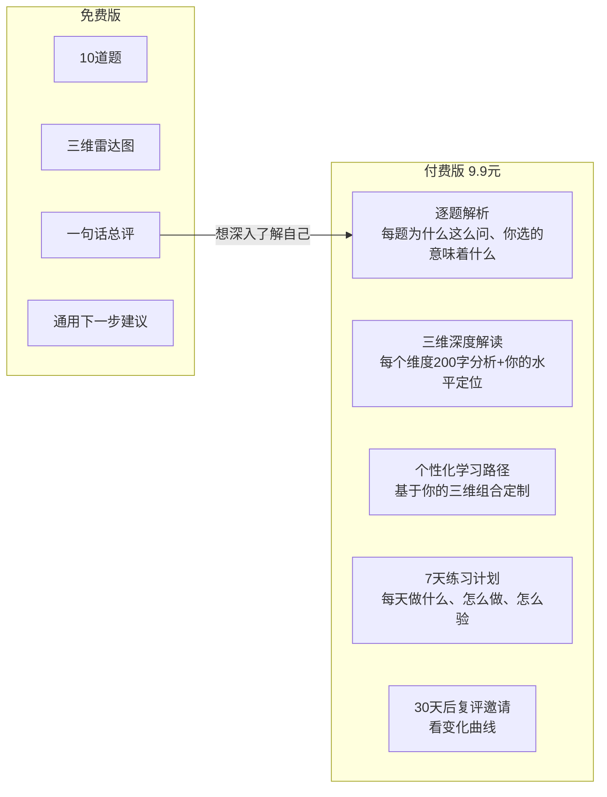
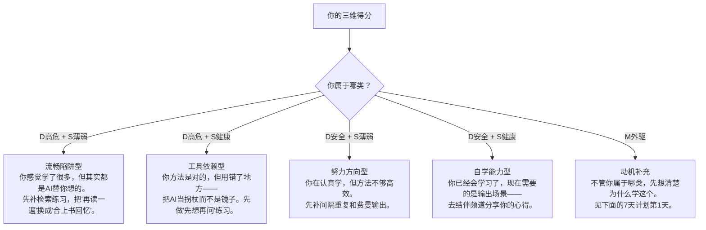
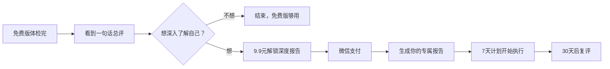
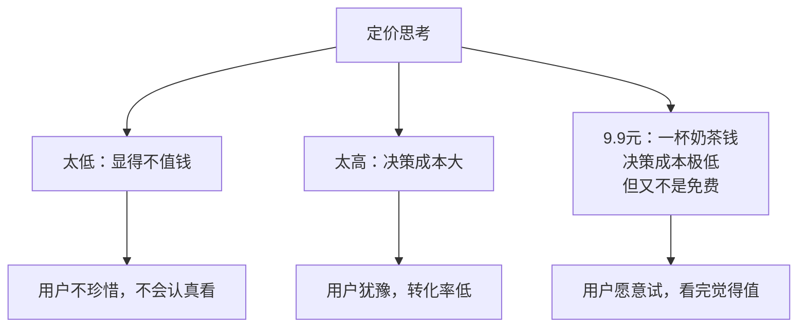

# 学习体检深度报告 · 付费版设计

> 定价：9.9 元
> 定位：免费版体检的深度升级，不是新课程、不是会员

---

## 一、免费版 vs 付费版对比

---

## 二、付费版内容结构

### 模块1：逐题解析（10题 × 每题100字）

每道题包含：
- **这道题在测什么**：维度 + 设计意图
- **你选的选项意味着什么**：行为模式解读
- **为什么这个选项得分高/低**：背后的学习科学原理

**示例（Q1 · 认知外包）：**

> **这道题在测什么**：遇到陌生概念时的第一反应——是先自己建构，还是直接外包给AI。
>
> **你选的是「直接问AI要答案」**：这是典型的流畅陷阱反应——感觉顺滑=觉得学会了。但学习发生在你的神经元连接上，AI替你想的那一步，你的突触没长出来。
>
> **为什么这个选项得3分（外包风险高）**：学习科学里有个概念叫「生成效应」——自己生成的内容比被动接收的记忆牢固3倍。直接要答案=跳过了生成过程。

### 模块2：三维深度解读（每维度200字）

**认知外包度（D）：**
- 你的得分：X/12
- 水平定位：安全/警戒/高危
- 200字解读：你现在的学习习惯里，哪些是"感觉学会了但其实没有"的模式
- 具体表现：你在哪些场景下最容易跳过自己思考

**策略健康度（S）：**
- 你的得分：X/9
- 水平定位：健康/一般/薄弱
- 200字解读：你现在的学习方法里，哪些是有效的，哪些是浪费时间的
- 具体表现：你最需要补哪个环节（检索练习/间隔重复/费曼输出）

**动机自主度（M）：**
- 你的得分：X/9
- 水平定位：内驱/混合/外驱
- 200字解读：你现在学习的动力来源是什么，可持续吗
- 具体表现：什么情况下你最容易放弃

### 模块3：个性化学习路径

基于三维组合的定制建议：

### 模块4：7天练习计划

每天一个小任务，15分钟以内：

| 天数 | 任务 | 怎么做 | 怎么验 |
|------|------|--------|--------|
| 第1天 | 写下你的学习目标 | 拿出一张纸，写清楚：你为什么学这个？学了之后要拿去做什么？ | 写完读一遍，如果答不出"然后呢"，重新写 |
| 第2天 | 先想再问 | 下次遇到不懂的，先自己想2分钟，写下你的猜测，再去查答案 | 对比你的猜测和答案的差距 |
| 第3天 | 合上书回忆 | 今天学完一个内容后，合上书，默写你能记住的所有要点 | 默写出来的内容不到30%？正常，明天继续 |
| 第4天 | 费曼讲解 | 把你学的一个概念，用大白话讲给一个不懂的人听（或者对着空气讲） | 讲不清楚的地方=你没学会的地方 |
| 第5天 | 间隔重复 | 把第1-4天学过的内容，快速回忆一遍，不要重读 | 能想起来多少？想不起来的标记一下 |
| 第6天 | 输出一次 | 把你这周学的东西，写成一段200字的总结，发到结伴频道的愈多·业 | 发出去，看别人有没有问题问你 |
| 第7天 | 复评体检 | 再做一次学习体检，对比第一次的分数 | 分数变化了吗？哪个维度变了？ |

### 模块5：30天后复评邀请

- 30天后，系统提醒你再做一次体检
- 对比两次的雷达图，看变化曲线
- 如果进步了，恭喜；如果没变化，看看是哪个维度卡住了

---

## 三、产品形态

**技术实现：**
- 报告在浏览器端生成（基于免费版的答题数据）
- 不需要服务器存储——你的答案本来就只在本机
- 付费只是"解锁内容"，不是"上传数据"

---

## 四、为什么是9.9元

**红线：**
- 不是课程，不是训练营
- 不是会员，不是订阅
- 一次付费，一次报告，没有后续自动扣费
