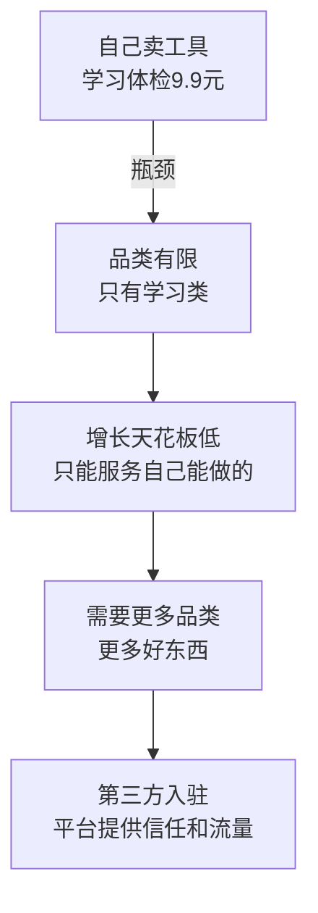
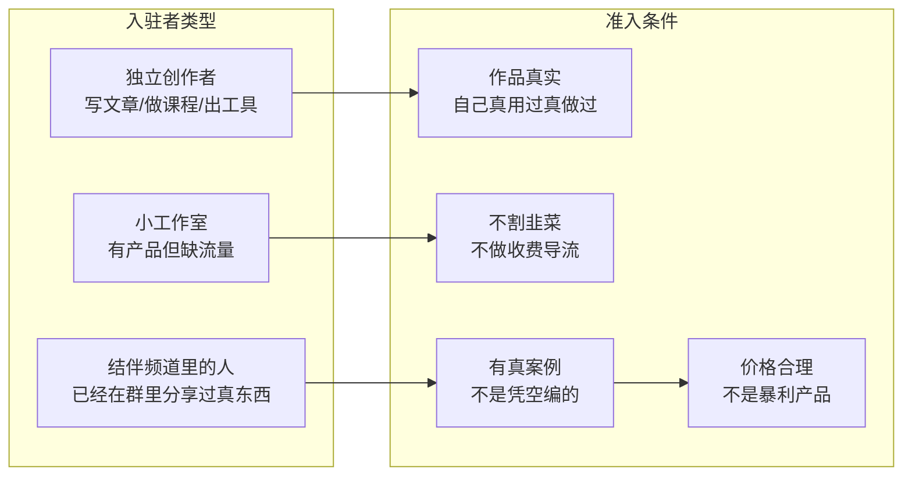
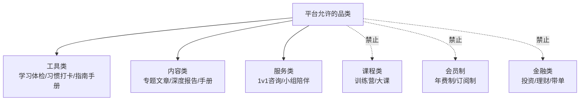
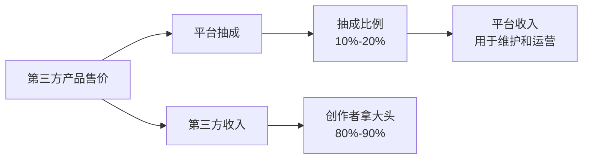
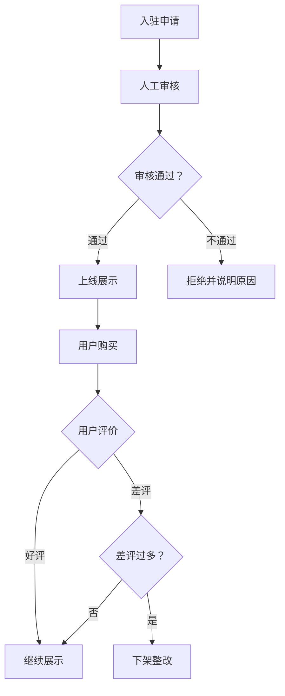
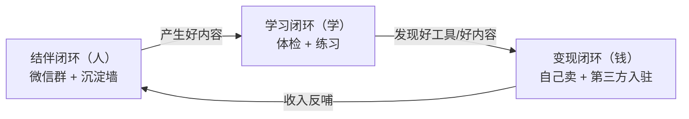
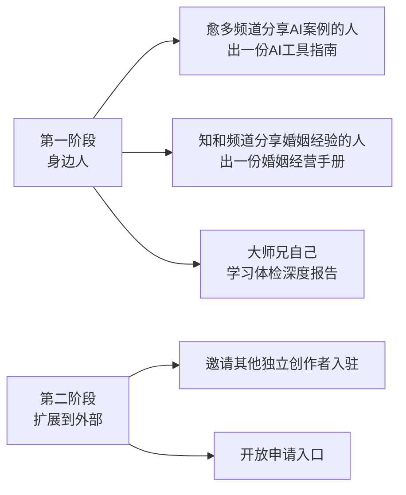

# 变现闭环 · 第三方入驻设计

> 从"自己卖工具"到"平台+第三方"的扩展设计

---

## 一、为什么要第三方入驻？

**核心逻辑**：道德大师兄做的是"信任入口"——用户信任这个品牌，所以愿意通过这个平台发现好东西。平台不需要自己生产所有内容，只需要保证"经过大师兄筛选的，都是靠谱的"。

---

## 二、谁可以入驻？

**最优先的入驻者：结伴频道里已经在分享的人。**
- 愈多·业频道里分享AI案例的人 → 可以做AI工具指南
- 知和·家频道里分享婚姻经验的人 → 可以做婚姻经营手册
- 恒与·伴频道里认识朋友的人 → 可以做认识朋友的方法论

这和品牌定位完全一致：**已经在群里分享真东西的人，把他们的分享产品化。**

---

## 三、卖什么？（品类边界）

**品类红线：**
- ✅ 工具：一次性付费，用一次算一次
- ✅ 内容：一次性付费，买一份算一份
- ✅ 服务：按次付费，不做长期套餐
- ❌ 课程：训练营/大课/系列课——这是割韭菜重灾区
- ❌ 会员：年费/订阅制——这是持续收割
- ❌ 金融：投资/理财/带单——这是杀猪盘重灾区

---

## 四、平台怎么赚钱？

**抽成原则：**
- 创作者拿大头（80-90%），平台拿小头（10-20%）
- 不是平台赚差价，是平台收"信任费"和"流量费"
- 价格由创作者定，平台不干预，但要审核价格合理性

---

## 五、怎么保证质量？

**三道质量门：**
1. **入驻审核**：大师兄人工审核，看作品是否真实、是否符合品牌调性
2. **上线后监控**：用户评价机制，差评多了就下架
3. **定期复审**：定期检查入驻者的产品是否还符合标准

---

## 六、和三环闭环的关系

**第三方入驻在三环里的位置：**
- 结伴闭环产生好内容（群里的人分享真东西）
- 学习闭环验证这些内容有效（体检→练习→复评）
- 变现闭环把这些内容产品化（自己做的 + 第三方做的）

---

## 七、第一阶段：先从身边人开始

**不要一上来就开放平台。先从结伴频道里已经在分享的人开始，验证模式跑通了再扩展。**

---

## 八、红线总结

| # | 红线 | 原因 |
|---|------|------|
| 1 | 不卖课程、不做训练营 | 割韭菜重灾区 |
| 2 | 不卖会员、不做订阅制 | 持续收割模式 |
| 3 | 不做金融、不做投资带单 | 杀猪盘重灾区 |
| 4 | 第三方必须人工审核 | 不是开放平台，是精选平台 |
| 5 | 差评多了必须下架 | 信任是核心资产 |
| 6 | 创作者拿大头 | 平台不是赚差价，是收信任费 |
